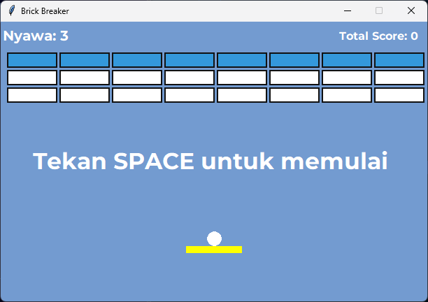

# Brick Breaker

Game Brick Breaker sederhana berbasis Python. Gerakkan paddle untuk memantulkan bola, hancurkan semua brick, dan raih skor setinggi mungkin sebelum kehabisan nyawa.

## Preview



## Fitur

- 24 brick dengan beberapa tingkat ketahanan.
- 3 nyawa dan tampilan skor secara langsung.
- Kontrol paddle menggunakan keyboard.
- Musik latar dan efek suara untuk permainan.
- Pesan saat permainan dimulai, dimenangkan, atau berakhir.

## Persyaratan

- Python 3
- Pygame
- Tkinter (umumnya sudah disertakan pada instalasi Python)

## Menjalankan aplikasi

1. Pastikan Python 3 sudah terpasang.
2. Pasang Pygame:

   ```bash
   python -m pip install pygame
   ```

3. Jalankan game dari folder proyek:

   ```bash
   python main.py
   ```

## Kontrol

| Tombol | Aksi |
| --- | --- |
| `SPACE` | Memulai permainan |
| `←` | Menggerakkan paddle ke kiri |
| `→` | Menggerakkan paddle ke kanan |

## Berkas audio

Berkas audio berikut harus berada di folder yang sama dengan `main.py`:

- `Backsound_compatible.wav` — musik latar
- `brickhancur.wav` — efek suara brick
- `nyawa_berkurang.wav` — efek suara saat kehilangan nyawa
- `kalah.wav` — efek suara saat permainan berakhir
